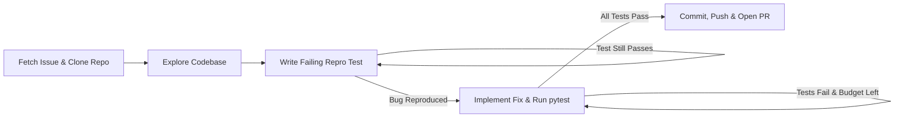

# Issue-to-PR Agent 🐛➡️✅

[](https://github.com/ramith-s/issue-to-pr-agent/actions/workflows/tests.yml)


An autonomous AI coding agent that takes a GitHub issue, clones the target repository inside an isolated sandbox, explores the codebase, writes a **failing `pytest` reproduction test**, iterates on a fix until the entire test suite passes, and opens a **GitHub Pull Request** explaining the root cause and verification.

## Architecture



### Why TDD-First Matters
Instead of blindly patching files, the agent enforces a strict **red -> green** verification loop:
1. **Red**: Generate a targeted `pytest` test from the issue report and verify it **fails** on the unmodified code.
2. **Green**: Patch the source code and run the **full** test suite inside the sandbox until all tests pass (including the new regression test).
3. **Reviewable PR**: Commit both the regression test and minimal fix on `fix/issue-<number>-<slug>`, then open a PR summarizing root cause, changes, and test output.

## Stack
- **Orchestration**: [LangGraph](https://github.com/langchain-ai/langgraph) `StateGraph` with typed state, retry budgets, and conditional routing
- **Sandboxing**: Isolated `DockerSandbox` (non-root container, `--memory=1g`, `--cpus=1`, `--pids-limit=256`, configurable `--network` mode) + `LocalSandbox` fallback for local dev/CI
- **Verification**: `pytest` executed inside the sandbox
- **GitHub Integration**: GitHub REST API v3 (fetch issues, push branch, open Pull Requests)
- **LLM Backends**: OpenAI Chat Completions, Anthropic Messages API, and a zero-key `demo` backend

## Project Structure

```text
issue-to-pr-agent/
├── docker/
│   └── Dockerfile.sandbox      # Non-root Python + git + pytest container
├── examples/
│   ├── sample_buggy_repo/      # Realistic Python package with an edge-case bug
│   └── sample_issue_42.json    # Sample GitHub issue payload for --demo
├── src/issue_to_pr/
│   ├── cli.py                  # Rich CLI entrypoint (`issue-to-pr`)
│   ├── config.py               # Environment & CLI configuration
│   ├── github_client.py        # GitHub REST API client + local demo client
│   ├── graph.py                # LangGraph StateGraph workflow
│   ├── llm.py                  # OpenAI, Anthropic, and Demo LLM backends
│   ├── models.py               # Pydantic models & LangGraph AgentState
│   ├── sandbox.py              # DockerSandbox and LocalSandbox
│   └── tools.py                # Safe workspace search, read, patch, git & pytest tools
└── tests/                      # Unit & end-to-end LangGraph workflow tests
```

## Quickstart

### 1. Install
```bash
python -m venv .venv
# Windows PowerShell: .venv\Scripts\Activate.ps1
# macOS/Linux:        source .venv/bin/activate
pip install -e ".[dev]"
```

### 2. Run the Offline End-to-End Demo (No API Keys Required)
This initializes a temporary bare git remote from `examples/sample_buggy_repo`, clones it into a fresh sandbox, reproduces Issue #42 with a failing `pytest` test, patches the bug, verifies all tests pass, pushes the fix branch, and generates the full Pull Request payload:

```bash
issue-to-pr --demo
```

### 3. Run Against a Real GitHub Issue (with Docker Sandbox)
Build the sandbox image:
```bash
docker build -t issue-to-pr-sandbox:latest -f docker/Dockerfile.sandbox .
```

Configure `.env` (copy from `.env.example`) and run:
```bash
issue-to-pr --issue https://github.com/owner/repo/issues/123 --sandbox docker --dry-run
```
Remove `--dry-run` when ready to push the branch and open the live Pull Request on GitHub.

### 4. Run the Test Suite
```bash
pytest -v
```

## Example Output

Running `issue-to-pr --demo` on the bundled sample repo (Issue #42: a flat discount larger than the subtotal produced a negative invoice total) generates this pull request:

> **fix: clamp discounted subtotal at zero (#42)**
>
> **Root cause:** `calculate_invoice_total` subtracted `flat_discount` from `subtotal` without clamping at `Decimal('0.00')`, so a coupon larger than the order produced negative tax and a negative total.
>
> **Changes:** added regression test `tests/test_issue_42.py`; clamped `discounted_subtotal` at zero in `billing.py`.
>
> **Verification:** full `pytest` suite passes inside the sandbox.

## Safety

- With the Docker backend, untrusted repository code runs inside a container as a non-root user, with CPU, memory and process limits and a configurable network mode.
- Retry budgets (`MAX_REPRO_ATTEMPTS`, `MAX_FIX_ATTEMPTS`) stop the agent from looping forever.
- `--dry-run` produces the full PR payload without pushing anything, so a human can review first.

## Author

**Ramith S** · B.E. Computer Engineering, JCT Institutions, Coimbatore
[GitHub](https://github.com/ramith-s) · [LinkedIn](https://www.linkedin.com/in/ramith-s-025bb3397)

## License

MIT, see [LICENSE](LICENSE).
